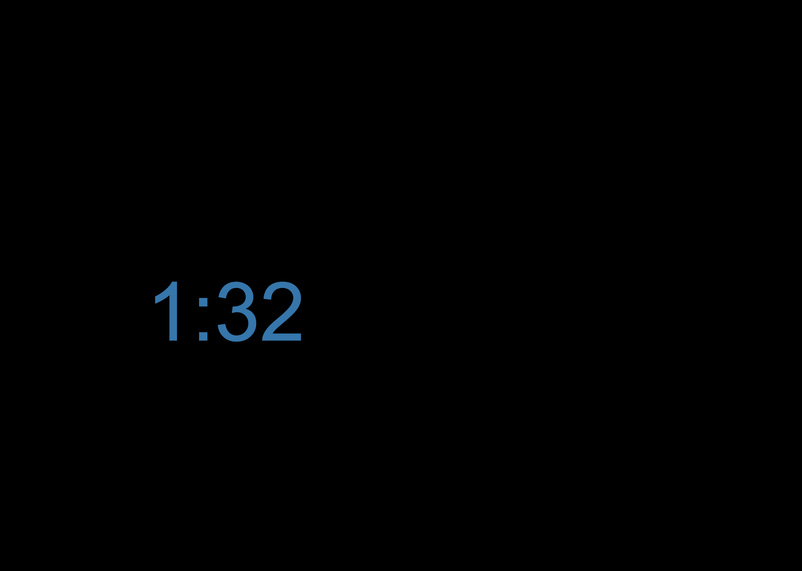
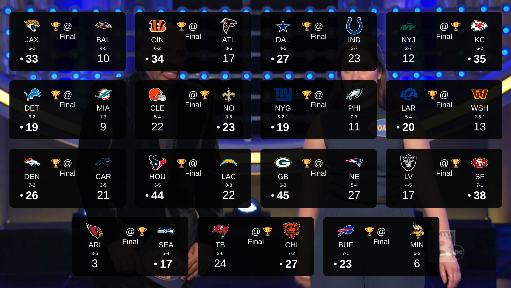

# Spectrum Mute Timer


This README and code were all generated by Grok (xAI). I’m a software engineer and could have done this myself, but I built this in my free time and didn’t want to invest the effort—felt too much like work! So, the code might be a bit rough around the edges, but I don’t care. I just dumped it into Grok and told it to tweak whatever I felt like. It was a fun experiment in coding with an LLM.

Later on, Claude (Anthropic) pitched in too: it fixed the scoreboard's emoji layout on Linux, made the scoreboard scale to fit the screen, got rid of the `<mini-guide>` side bar, and brought this README up to date. Same deal—I just told it what bugged me.

This is a Chrome extension that mutes and covers the Spectrum TV video player during commercial breaks, featuring a bouncing countdown timer with color cycling for OLED TV protection. It also has a live NFL scoreboard overlay so you can check the other games during a break. Ideal for watching NFL Football games. Use hotkeys to mute and hide ads:  
- **3**: Start/stop a 30-second timer  
  - For "30-second timeouts"  
- **2**: Start/stop a 2-minute timer  
  - For all commercial breaks: change of possession, full timeouts, injury timeouts, 2-minute warnings, etc.  
- **1**: Start a 1-minute timer or add 1 minute to the current one  
  - For creating a custom-length timer—use it however you see fit!
- **`` ` ``** (backtick / tilde key): Show/hide the NFL scoreboard  

This extension is designed for Spectrum TV users who want to automate muting and screen covering during commercials, with built-in safeguards like cursor hiding and anti-burn-in features for OLED displays.

## Features

- **Hotkey Controls**:  
  - Press **3** to mute/cover for 30 seconds (toggle on/off).  
  - Press **2** to mute/cover for 2 minutes (toggle on/off).  
  - Press **1** to start a 1-minute timer (or extend the current timer by 1 minute if active).
  - Press **ArrowLeft** to toggle the overlay to 66% width (right-aligned) or back to full width.
  - Press **ArrowRight** to toggle the overlay to 66% width (left-aligned) or back to full width.
  - Press **`` ` ``** (backtick / tilde key) to show or hide the NFL scoreboard. Clicking anywhere on the scoreboard also closes it.

- **Visual Feedback**: A large, bouncing countdown timer (MM:SS format) displays on a black overlay, preventing accidental viewing of ads.  

- **OLED Protection**:  
  - The timer text cycles through darker, richer colors (deep blue, emerald green, amber, burgundy, steel gray) every 2 seconds.  
  - The timer bounces smoothly around the screen at a steady speed, avoiding static positioning to minimize screen burn-in.  

- **NFL Scoreboard Overlay** (live data from ESPN):  
  - One card per game this week, with team logos, records, and scores.  
  - **In progress**: quarter and game clock (or Halftime), down & distance, field position, 🏈 next to the team with possession, and ○ next to the team that's leading.  
  - **Final**: 🏆 and a bold score with • for the winner (🏆 on both sides for a tie).  
  - **Not started**: day, date, and kickoff time (Eastern).  
  - Automatically scales to fill the player, so it fits in both windowed and fullscreen mode without browser zooming. It picks whichever column count makes the cards biggest—for a 15-game week on a 16:9 screen that's 4 rows of 4, with the last 3 centered—and re-fits when the window is resized or you go fullscreen.  
  - Emoji icons use your platform's own emoji (Apple, Noto, Segoe, etc.) but are drawn into fixed-size boxes, so the layout is the same on macOS, Linux, and Windows.  

- **Additional Enhancements**:  
  - Automatically unmutes and uncovers the video when the timer expires.  
  - Hides the mouse cursor during inactivity for a distraction-free experience.  
  - Removes Spectrum's `<mini-guide>` side bar menu, which is easy to trigger by accident (and also keeps the top/bottom player overlays from popping up).  
  - Works only on Spectrum TV pages (`https://watch.spectrum.net/*`).  

## Installation

This extension is not published to the Chrome Web Store. To install it manually on Chrome (or any Chromium-based browser like Edge, Brave, or Vivaldi), enable Developer Mode and load it unpacked. Follow these steps:

1. **Download the Extension**:  
   - Clone or download this repository:  
     ```
     git clone https://github.com/JESShEart/mute-plugin.git
     ```  
     Or click the green "Code" button > "Download ZIP" and extract the files.  

2. **Open Chrome Extensions Page**:  
   - Go to `chrome://extensions/` (or `edge://extensions/` for Edge).  

3. **Enable Developer Mode**:  
   - Toggle "Developer mode" on in the top-right corner.  

4. **Load the Extension**:  
   - Click "Load unpacked."  
   - Navigate to the downloaded/extracted `mute-plugin` folder (the one containing `manifest.json` and `script.js`).  
   - Select the folder and click "Select Folder."  

5. **Verify Installation**:  
   - The extension should appear in the list with its icon.  
   - Navigate to a Spectrum TV page (e.g., `https://watch.spectrum.net/livetv`) to test.  
   - Press '3', '2', or '1' to activate—the video should mute, and the black overlay with bouncing timer should appear.  
   - Press `` ` `` to bring up the scoreboard.  

**Note**: The extension works only on Spectrum TV pages. Reload the page if needed after installation.

## Usage

1. **When viewing Live TV**:  
   - When commercials start, press **3** (30 seconds), **2** (2 minutes), or **1** (1 minute) to activate the overlay.  
   - The video mutes, a black cover appears, and a large bouncing timer starts counting down.  
   - The timer text changes colors every 2 seconds and moves steadily around the screen.  

2. **Extending or Canceling**:  
   - Press **3** or **2** again to cancel early (unmutes and removes the overlay).  
   - Press **1** while active to add 1 minute to the current timer.  
   - The timer auto-expires, restoring sound and visibility.  

3. **Picture-in-Picture Commercials**:  
   - When the broadcast shows the game on one side and a commercial on the other, press **ArrowLeft** or **ArrowRight** while the timer is running to cover only 66% of the screen on that side. It stays muted. Press the same key again to go back to full width.  

4. **Checking Other Games**:  
   - Press the **backtick** key (`` ` ``) to show the scoreboard over the player (it works with or without the timer running). Press it again, or click the scoreboard, to close it. Scores are fetched fresh each time it opens.  

5. **Cursor Hiding**:  
   - The mouse cursor hides during inactivity on the page for immersion (moves on hover/click).  

## Screenshots

  
  

## Troubleshooting

- **Hotkeys Not Working**: Ensure you’re on a Spectrum TV page (`https://watch.spectrum.net/*`). Focus the video player and try again.  
- **Overlay Not Appearing**: Check the console (`F12` > Console) for errors. Reload the page or extension.  
- **Scoreboard Says "Error loading scores"**: The ESPN scoreboard API couldn't be reached. Close and reopen the scoreboard to retry; check the console for details.  
- **Icon Not Showing**: Ensure `icon128.png` is in the root folder and `manifest.json` references it correctly. Restart the browser.  
- **Browser Compatibility**: Works on Chrome 115+ and other up-to-date Chromium browsers (Edge, Brave, Vivaldi). Not tested on Firefox (requires adjustments).  

If issues persist, open an issue on this repo or check the browser’s extension errors.

## Changelog

- **v1.4.2 (November 10, 2026)**:  
  - Removes Spectrum's `<mini-guide>` side bar menu automatically.  

- **v1.4.1 (November 10, 2026)**:  
  - Fixed scoreboard emoji (🏈/🏆) causing line wrapping and spacing problems on Linux and other platforms whose emoji are sized differently than macOS. Emoji are now drawn into fixed-size boxes using the platform's own emoji.  
  - Scoreboard now scales to fill the player automatically (windowed or fullscreen) and re-fits on resize.  

- **v1.4.0 (October 19, 2025)**:  
  - Split the code into `mute_overlay.js`, `tilde_overlay.js`, and `tilde_overlay.css`.  
  - Scoreboard: 🏈 possession indicator, 🏆 for final winners, • for winners and ○ for current leaders, Halftime display, day of week for upcoming games, and always-fresh data.  

- **v1.3.0 (October 18, 2025)**:  
  - Added the NFL scoreboard overlay (backtick/tilde key) using ESPN's scoreboard API.  

- **v1.2.0 (October 12, 2025)**:  
  - Added arrow left/right hotkeys to allow watching of the game when the TV broadcast does a picture in picture showing a commercial on one side of the screen. 66% of the screen will be blocked on either side and it will remain muted.  

- **v1.1.0 (September 21, 2025)**:  
  - Added bouncing timer with color cycling for OLED protection.  
  - Implemented hotkeys: '3' (30s), '2' (2m), '1' (1m or +1m).  
  - Fixed premature overlay closure bug.  
  - Enhanced cursor hiding during inactivity.  

- **v1.0.0**: Initial release with basic muting functionality.

## Development

- **Files**:  
  - `manifest.json`: Extension configuration (Manifest V3).  
  - `script.js`: Hotkeys, cursor hiding, `<mini-guide>` removal, and keeping the player unmuted/overlay attached when the page changes.  
  - `mute_overlay.js`: Mute cover, countdown timer, bouncing animation, color cycling, and the 66% left/right modes.  
  - `tilde_overlay.js`: NFL scoreboard overlay—fetches ESPN data, builds the game cards, draws the emoji icons, and scales the grid to fit.  
  - `tilde_overlay.css`: Styles for the scoreboard overlay.  
  - `icon128.png`: Extension icon (128x128 PNG).  
  - `screenshots/`: Images used in this README.  

- **Building/Updating**:  
  - Edit `mute_overlay.js` for timer behavior (e.g., adjust `dx`/`dy` bounce speeds or the `colors` list).  
  - Edit `tilde_overlay.js` / `tilde_overlay.css` for the scoreboard. Cards are styled at a fixed design size (500px wide) and the whole grid is zoomed to fit, so change sizes in the CSS as if for a single fixed-size card.  
  - Reload the extension in `chrome://extensions/` (click the reload icon).  

- **License**: MIT (feel free to fork and modify).  

## Contributing

Pull requests welcome! For major changes, open an issue first.  

1. Fork the repo.  
2. Create a feature branch (`git checkout -b feature/amazing-feature`).  
3. Commit changes (`git commit -m 'Add amazing feature'`).  
4. Push to the branch (`git push origin feature/amazing-feature`).  
5. Open a Pull Request.  

## License

MIT License - see [LICENSE](LICENSE) (add one if not present).  

---

*Last updated: November 10, 2026*
